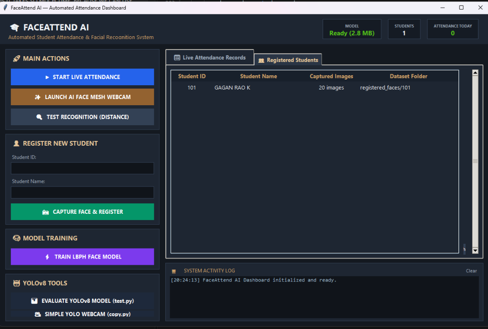
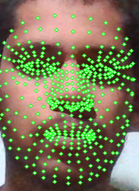
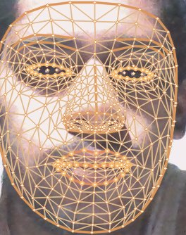
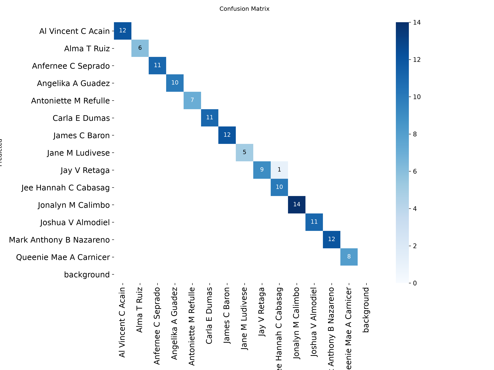
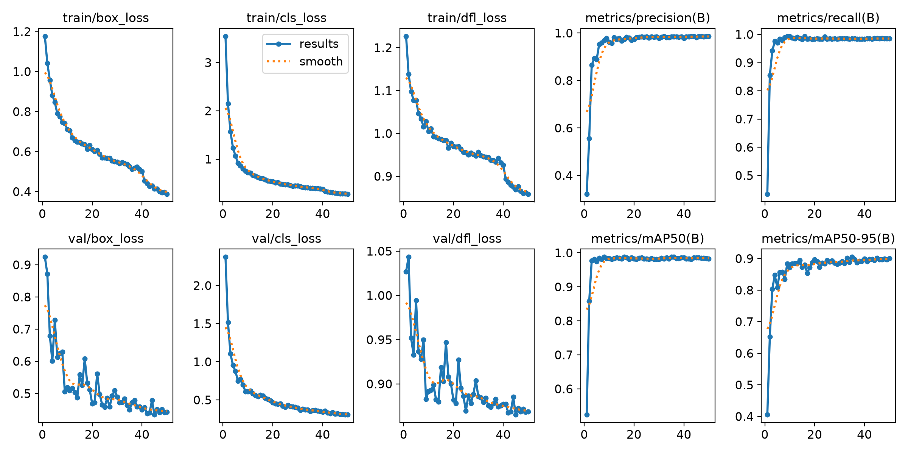
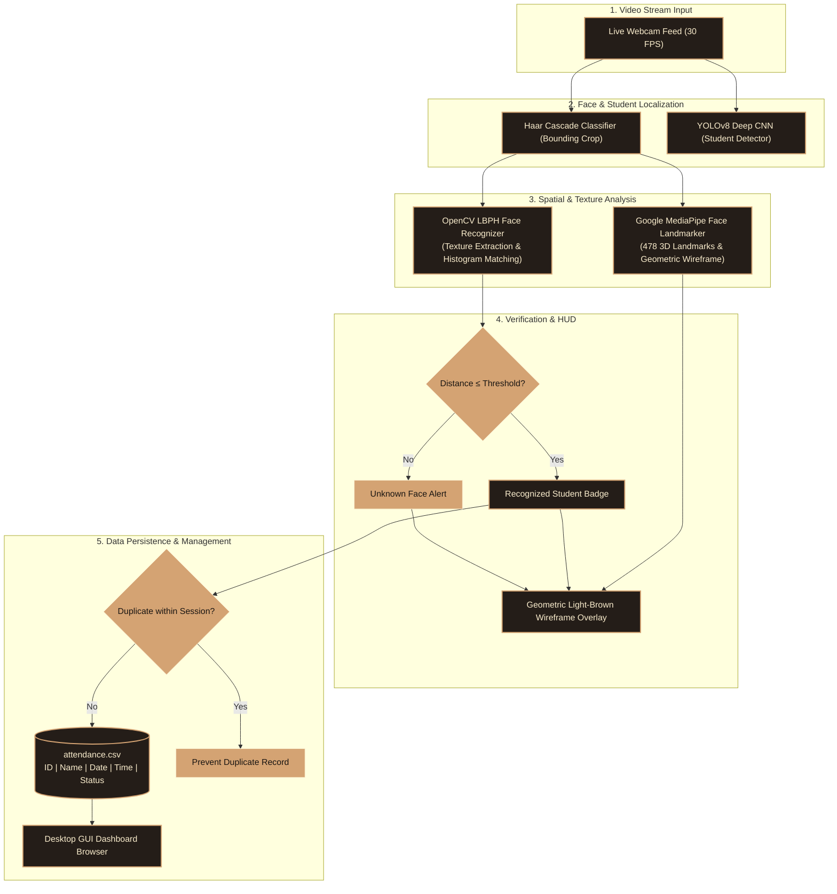

<div align="center">

# 🎓 FaceAttend AI: Real-Time Automated Attendance System
### Next-Generation Contactless Attendance Management via 3D Facial Mesh & Deep Learning

[](https://www.python.org/)
[](https://opencv.org/)
[](https://ultralytics.com/)
[](https://developers.google.com/mediapipe)
[](LICENSE)
[](https://github.com/)

<p align="center">
  <b>A production-grade, contactless student attendance management system powered by a Hybrid AI Architecture combining Deep Convolutional Neural Networks (YOLOv8), Google MediaPipe 3D Spatial Facial Mesh, and OpenCV Local Binary Patterns Histograms (LBPH), managed via a modern Tkinter Desktop Dashboard.</b>
</p>

</div>

---

## 📑 Table of Contents
1. [Overview](#-overview)
2. [Live Working Figures & Interface](#-live-working-figures--interface)
3. [System Architecture](#-system-architecture)
4. [Technology Stack](#-technology-stack)
5. [Key Features](#-key-features)
6. [Repository Structure](#-repository-structure)
7. [Installation & Setup](#-installation--setup)
8. [How to Run](#-how-to-run)
9. [Dataset & Model Training](#-dataset--model-training)
10. [Attendance CSV Schema](#-attendance-csv-schema)
11. [License & Credits](#-license--credits)

---

## 📌 Overview

Traditional manual attendance methods suffer from proxy marking, wasted lecture hours, and human error. **FaceAttend AI** replaces manual paper attendance with a fast, touchless, and accurate computer vision pipeline:

* **Executive Desktop Dashboard:** Built with a custom Roasted Espresso (`#191512`) and Warm Caramel (`#d4a373`) theme, offering complete control over enrollment, training, real-time logging, and records inspection in a single application.
* **Hybrid Vision Engine:** Combines deep learning spatial localization (YOLOv8), 478 3D geometric landmark regression (MediaPipe), and micro-texture identity classification (LBPH).
* **Automated Data Persistence:** Real-time CSV logging with timestamping, multi-frame stabilization, and duplicate check mechanisms.

---

## 📸 Live Working Figures & Interface

<div align="center">

### Figure 1: Executive Desktop GUI Dashboard

*Figure 1: Unified Desktop GUI dashboard showing live system status indicators, 1-click action triggers, inline student enrollment, and tabular records browser with compact management controls.*

<br/>

### Figure 2: Real-Time Live Attendance with 3D Geometric Face Mesh

*Figure 2: Live camera stream operating at 30+ FPS featuring the light-brown geometric facial wireframe (with open eye/mouth contours and zero clutter dots), status HUD cards, and identity verification badges.*

<br/>

### Figure 3: Biometric Face Recognition & Distance Metric Scoring

*Figure 3: Instantaneous identity verification display showing matched student name, roll number, and real-time Euclidean texture distance score.*

<br/>

### Figure 4: YOLOv8 Object Detection Confusion Matrix

*Figure 4: Normalized confusion matrix demonstrating high detection precision and recall across student dataset validation classes.*

<br/>

### Figure 5: YOLOv8 Training Loss & Precision/Recall Convergence Curves

*Figure 5: Training and validation loss curves (Box, Class, DFL) across training epochs illustrating rapid convergence and high mean average precision (mAP50).*

</div>

---

## 🏗️ System Architecture

The following diagram illustrates the complete end-to-end data processing and inference pipeline:



---

## 🛠️ Technology Stack

| Layer | Component | Description |
| :--- | :--- | :--- |
| **Language** | Python 3.10+ | Core programming runtime. |
| **Deep Learning** | **YOLOv8 (Ultralytics)** | Deep Convolutional Neural Network for student localization (`best.pt`, `yolov8n.pt`). |
| **3D Face Mesh** | **MediaPipe Landmarker** | Google regression network predicting 478 3D facial coordinates in real-time (`face_landmarker.task`). |
| **Texture Classifier** | **OpenCV LBPH** | Local Binary Patterns Histograms for rapid, GPU-independent biometric matching (`face_model.yml`). |
| **Detection** | **Haar Cascades** | High-speed frontal face cropping for dataset generation (`haarcascade_frontalface_default.xml`). |
| **GUI Framework** | **Python Tkinter & ttk** | Executive dark espresso and caramel dashboard with multithreaded workers (`gui_app.py`). |
| **Persistence** | **CSV & YAML** | Tabular records (`attendance.csv`, `students.csv`) and serialized weights (`face_model.yml`). |
| **Launcher** | **Windows Batch** | 1-Click launcher (`run_app.bat`). |

---

## ✨ Key Features

* **Instantaneous 1-Click Enrollment:** Captures 20 balanced grayscale facial crops per student and maps identities in `students.csv`.
* **Sub-3-Second Model Training:** Compiles the LBPH histogram model locally on standard CPUs without requiring expensive cloud GPUs.
* **Modern Geometric Wireframe:** Upgraded facial mesh using 81 key structural contours with open eye and mouth openings, completely eliminating messy dense dotted overlays.
* **Smart Attendance Tracking:** Computes session presence, prevents duplicate logging within session cooldowns, and generates clean CSV logs.
* **Tabular Records Manager:** Inspect attendance records and the student roster directly inside the GUI, with 1-click **Refresh** and **Open CSV** buttons.

---

## 📂 Repository Structure

```text
Student-Attendance-Face-Recognition/
├── assets/                          # Documentation screenshots & figures
│   ├── gui_dashboard.png            # Figure 1: GUI Dashboard
│   ├── live_mesh_attendance.png     # Figure 2: Live Wireframe Attendance
│   ├── recognition_test.jpg         # Figure 3: Face Recognition Distance Score
│   ├── confusion_matrix.png         # Figure 4: YOLOv8 Confusion Matrix
│   └── yolo_results.png             # Figure 5: YOLOv8 Training Results
├── registered_faces/                # Enrolled student datasets (20 images/student)
│   ├── 101/                         # Student ID folder
│   └── .gitkeep
├── runs/
│   └── detect/train/weights/best.pt # Custom fine-tuned YOLOv8 model weights
├── attendance.csv                   # Daily attendance records
├── attendance.py                    # Unified live attendance engine with 3D wireframe
├── face_labels.txt                  # Numerical label to student ID mappings
├── face_landmarker.task             # Google MediaPipe 3D face landmarker model
├── face_model.yml                   # Serialized OpenCV LBPH trained model
├── gui_app.py                       # Main Executive Desktop GUI Application
├── recognize_face.py                # Standalone face recognition tester
├── register_student.py              # CLI student enrollment module
├── requirements.txt                 # Python project dependencies
├── run_app.bat                      # 1-Click Windows batch launcher
├── students.csv                     # Master student roster database
├── test.py                          # YOLOv8 evaluation script
├── train.py                         # YOLOv8 training script
├── train_face_model.py              # LBPH face model trainer
├── webcam.py                        # Standalone 3D mesh wireframe demo
├── yolov8n.pt                       # Pre-trained base YOLOv8 model
├── LICENSE                          # MIT License
└── README.md                        # Documentation
```

---

## 🚀 Installation & Setup

### 1. Prerequisites
* **Operating System:** Windows 10/11, macOS, or Ubuntu Linux.
* **Python:** Python 3.10, 3.11, or 3.14.
* **Hardware:** Any standard webcam and multi-core CPU.

### 2. Clone the Repository
```bash
git clone https://github.com/YOUR_USERNAME/Student-Attendance-Face-Recognition.git
cd Student-Attendance-Face-Recognition
```

### 3. Create & Activate a Virtual Environment
```bash
# Windows
python -m venv venv
venv\Scripts\activate

# Linux / macOS
python3 -m venv venv
source venv/bin/activate
```

### 4. Install Dependencies
```bash
pip install -r requirements.txt
```

---

## ▶️ How to Run

### Option A: Executive Desktop GUI (Recommended)
Launch the unified dashboard:
```bash
python gui_app.py
```
*(On Windows, you can also double-click **`run_app.bat`**)*

#### Workflow:
1. **Enroll:** Type Student ID and Name, then click **`Capture Face & Register`**.
2. **Train:** Click **`Train LBPH Face Model`** (takes ~2 seconds).
3. **Attend:** Click **`Start Live Attendance`** to open the real-time webcam tracking window. Press **`q`** to exit.
4. **Inspect:** Switch between the *Live Attendance Records* and *Registered Students* tabs in the GUI, or click **`Open attendance.csv`** to inspect the file in Excel.

---

### Option B: Command-Line Interface (Step-by-Step)

Each module can also be executed independently via terminal:

```bash
# 1. Enroll a new student (captures 20 face images)
python register_student.py

# 2. Train the LBPH recognition model
python train_face_model.py

# 3. Launch live attendance logging with 3D geometric mesh
python attendance.py

# 4. Test recognition distance and match confidence
python recognize_face.py

# 5. Run standalone geometric facial mesh demo
python webcam.py
```

---

## 📊 Dataset & Model Training

### LBPH Face Recognition Training
The LBPH classifier takes $200 \times 200$ grayscale face crops collected during registration, extracts $3 \times 3$ circular pixel neighborhoods, computes the Local Binary Pattern codes, and constructs spatial histograms.

$$\text{LBP}(x_c, y_c) = \sum_{p=0}^{P-1} s(i_p - i_c) 2^p \quad \text{where} \quad s(x) = \begin{cases} 1 & \text{if } x \ge 0 \\ 0 & \text{if } x < 0 \end{cases}$$

### YOLOv8 Object Detection Fine-Tuning
The YOLOv8 deep detector is pre-trained on the Roboflow Student Attendance dataset. To retrain or evaluate:
```bash
# Train on custom dataset
python train.py

# Evaluate test split performance
python test.py
```

---

## 📄 Attendance CSV Schema

Logged records in **`attendance.csv`** are formatted as follows:

| Field | Type | Description | Example |
| :--- | :---: | :--- | :--- |
| `Student_ID` | String / Int | Unique identifier of the student | `101` |
| `Name` | String | Full name registered in database | `GAGAN RAO K` |
| `Date` | Date (`YYYY-MM-DD`) | Date of attendance capture | `2026-11-08` |
| `Time` | Time (`HH:MM:SS`) | Exact timestamp of attendance capture | `08:35:12` |
| `Status` | String | Status flag logged by the system | `Present` |

---

## 📄 License & Credits

This project is licensed under the **MIT License** — see the [LICENSE](LICENSE) file for complete details.

### Author
* **GAGAN RAO K** — *Design, Machine Learning Architecture & Development*
* Feedback and contributions are welcome! Submit a Pull Request or open an Issue.
